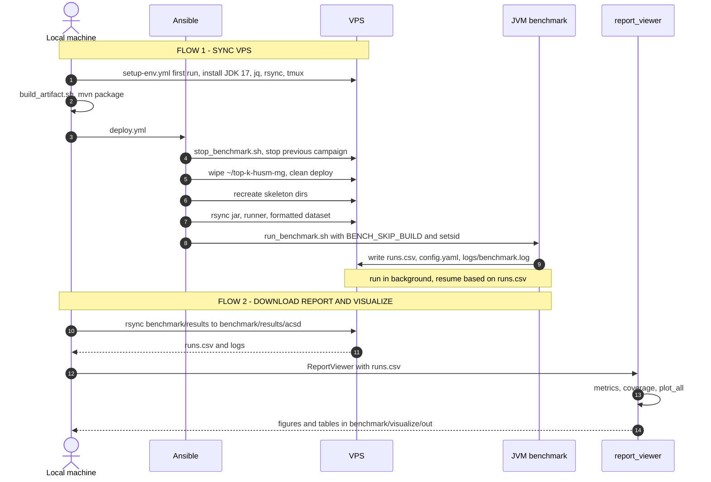

# Environment Setup Notes

## 1. Python

```bash
# Run on local.
sudo apt update
sudo apt install python3 python3-pip
pip install -r requirements.txt --break-system-packages
python3 --version
```


## 2. Run on VPS

### Flow




```bash
# Setup (one time)
ansible-playbook benchmark/compute/.ansible/setup-env.yml -k

# Run: build locally, then deploy and run the campaign on the VPS
./benchmark/runner/build_artifact.sh
ansible-playbook benchmark/compute/.ansible/deploy.yml -k

# Download the report locally for visualization
rsync -avz root@<vps-host>:~/top-k-husm-mg/benchmark/results/ benchmark/results/acsd
```

## 3. Measuring memory (benchmark)
Peak memory follows the SPMF `MemoryLogger` convention
(https://data-mining.philippe-fournier-viger.com/spmfs-architecture-4-the-memorylogger/):

- `peak_heap_bytes`: peak of the JVM heap pools (`MemoryPoolMXBean` peak usage).
- `mem_logger_peak_bytes`: sampled `used` heap every `--mem-logger-ms` ms, same idea as SPMF.
- `peak_live_bytes`: sampled live heap every `--live-sample-ms` ms (off by default).

All of them are measured inside one JVM around `MgHUSM.mine(...)`, so graph loading is excluded.

---

## 4. Dev workflow (run Java trực tiếp)

### 4.1. Yêu cầu

```bash
java -version   # cần JDK 17+ (pom đặt maven.compiler.release=17)
mvn -version
```

### 4.2. Build jar

```bash
# Từ thư mục gốc repo
cd artifact && mvn -q clean package && cd ..

# Hoặc dùng script có sẵn (tự chọn JAVA_HOME)
./benchmark/runner/build_artifact.sh
```

Jar ra ở `artifact/target/top-k-husm-mg-0.2.0-SNAPSHOT.jar`. Manifest trỏ tới
`topk.husm.mg.cli.MgMain` (dispatcher), nên có thể chạy:

```bash
java -jar artifact/target/top-k-husm-mg-0.2.0-SNAPSHOT.jar      # in usage rồi exit 2
```

Đặt biến cho gọn (dùng cho tất cả lệnh bên dưới):

```bash
JAR=$(ls artifact/target/top-k-husm-mg-*.jar | head -n1)
CP=$JAR          # chạy từ jar
# CP=artifact/target/classes   # hoặc chạy từ class đã compile (dev nhanh)
DATA=benchmark/dataset/formated
```

### 4.3. Compile nhanh khi dev (không đóng jar)

```bash
cd artifact && mvn -q compile && cd ..

# chạy trực tiếp từ target/classes
java -cp artifact/target/classes topk.husm.mg.cli.MgTopKMain college-msg \
  --edges-file benchmark/dataset/formated/college-msg.txt --K 10 --mer 1 -v
```

> Mặc định `--processed-dir ../../../../realistic-dataset/processed` (đường dẫn tương đối).
> Chạy từ root repo thì luôn truyền `--edges-file` để tránh sai đường dẫn.

### 4.4. Chạy miner (Top-K và min-util)

```bash
# Top-K: giữ K pattern tốt nhất, theta động
java -Xmx3g -cp "$CP" topk.husm.mg.cli.MgTopKMain dblp-multigraph \
  --edges-file "$DATA/dblp-multigraph.txt" \
  --K 100 --mer 2 --nlabels 20 --label-mode random --wdist gaussian \
  --ieu-bound ivu --incremental-domains true \
  --out artifact/output/ --out-all -v

# Min-util: giữ mọi pattern có u >= min-util (không có theta động)
java -Xmx3g -cp "$CP" topk.husm.mg.cli.MgMinUtilMain college-msg \
  --edges-file "$DATA/college-msg.txt" --min-util 1000 --mer 1

# Dispatcher: tự chọn Top-K hay min-util theo tham số
java -cp "$CP" topk.husm.mg.cli.MgMain college-msg \
  --edges-file "$DATA/college-msg.txt" --no-top-k --min-util 500
```

Các flag hay dùng:

| Flag | Ý nghĩa |
| --- | --- |
| `--K N` | số pattern Top-K (mặc định 10) |
| `--mer N` | multiplicity tối đa của cạnh (mặc định 1) |
| `--min-util U` / `--minutil U` | ngưỡng utility cố định (mặc định 0) |
| `--no-top-k`, `--enable-top-k false` | tắt Top-K, chuyển sang min-util |
| `--ieu-bound ivu\|eu\|ceu` | loại bound dùng để prune |
| `--no-incremental-domains` | tắt incremental domains |
| `--noprune` / `--prune false` | tắt prune |
| `--max-m N`, `--max-v N` | giới hạn số cạnh / số đỉnh của pattern |
| `--out FILE\|DIR/`, `--out-all` | ghi report text (mặc định vào `artifact/output/`) |
| `-v` / `--verbose [2]`, `--trace`, `--log-level L`, `--log-file F` | logging |
| `--profile [off\|wall\|full]` | profile từng bước (env `MG_PROFILE`) |
| `--no-esv-cache` | tắt memo hoá ESV (ablation O2) |

Env: `MG_OUTPUT_DIR` (thư mục report mặc định), `MG_LOG_LEVEL`, `MG_PROFILE`.

### 4.5. Unit test

```bash
cd artifact
mvn -q test                                   # tất cả test
mvn -q test -Dtest=MgHUSMEquivalenceTest      # một class
mvn -q test -Dtest=MgMinCodeTest#someMethod   # một method
cd ..
```

### 4.6. JMH micro-benchmark (tuỳ chọn)

```bash
cd artifact
mvn -q test-compile
mvn -q dependency:build-classpath -Dmdep.includeScope=test -Dmdep.outputFile=/tmp/mg-cp.txt

java -cp "target/classes:target/test-classes:$(cat /tmp/mg-cp.txt)" \
  topk.husm.mg.DataMiningBenchmark \
  -p dataset=college-msg -p K=10 -p mer=1 -p ieuBound=ivu

cd ..
# tham số JMH khác: -wi 3 -i 5 -f 1 -r 2s -p mer=1,2,3
```

---

## 5. Benchmark chạy trực tiếp bằng Java

Có 2 entry point benchmark, mỗi JVM chạy đúng **một cấu hình** và in **một dòng JSON** ra stdout:

| Class | Dùng cho |
| --- | --- |
| `topk.husm.mg.cli.MgBenchOne` | dataset trong `benchmark/dataset/formated/` (loader chuẩn) |
| `topk.husm.mg.cli.MgBenchMugram` | protocol mặc định của MuGraM cho multigraph (DBLP) |

### 5.1. Một cấu hình (MgBenchOne)

```bash
JAR=$(ls artifact/target/top-k-husm-mg-*.jar | head -n1)

java -Xmx3g -cp "$JAR" topk.husm.mg.cli.MgBenchOne dblp-multigraph \
  --edges-file benchmark/dataset/formated/dblp-multigraph.txt \
  --K 100 --mer 2 --nlabels 20 \
  --label-mode random --wdist gaussian \
  --ieu-bound ivu --incremental-domains true --enable-top-k true \
  --warmup 1 --repeats 3 --mem-logger-ms 10 \
  --out artifact/output/bench-dblp.json
```

Kết quả (một dòng JSON):

```json
{"dataset":"dblp-multigraph","K":100,"enable_top_k":true,"min_util":0.0000,...,"cpu_ms":123.4,"wall_ms":130.1,"alloc_bytes":...,"peak_heap_bytes":...,"mem_logger_peak_bytes":...,"warmup":1,"repeats":3}
```

Lưu ý: `--warmup` + `--repeats` lần mine chạy trong **cùng một JVM**, thời gian báo cáo là
median của các lần sau warmup; `--timeout` (khi dùng script) phải tính theo
`timeout_sec * (warmup + repeats)`.

### 5.2. MuGraM / DBLP (MgBenchMugram)

```bash
java -Xmx3g -cp "$JAR" topk.husm.mg.cli.MgBenchMugram \
  --edges-file benchmark/dataset/formated/dblp-multigraph.txt \
  --K 10 --mer 1 --nlabels 20 --seed 42 --wdist gaussian \
  --label-mode random --ieu-bound ivu --incremental-domains true \
  --prune true --warmup 3 --repeats 5 \
  --mem-logger-ms 10 --out artifact/output/bench-mugram.json
```

### 5.3. Quét nhiều cấu hình bằng shell (không qua runner)

```bash
JAR=$(ls artifact/target/top-k-husm-mg-*.jar | head -n1)
OUT=benchmark/results/manual; mkdir -p "$OUT"

for ds in college-msg dblp-multigraph; do
  for K in 10 100; do
    for mer in 1 2; do
      java -Xmx3g -cp "$JAR" topk.husm.mg.cli.MgBenchOne "$ds" \
        --edges-file "benchmark/dataset/formated/$ds.txt" \
        --K "$K" --mer "$mer" --nlabels 20 --label-mode random --wdist gaussian \
        --ieu-bound ivu --incremental-domains false --enable-top-k true \
        --warmup 1 --repeats 3 --mem-logger-ms 10 \
        >> "$OUT/runs.jsonl"
    done
  done
done
```

Gom `runs.jsonl` thành CSV (`jq -s -r`):

```bash
jq -s -r '(.[0]|keys_unsorted) as $h
  | ($h|@csv),
    (.[] | [.[ $h[] ]] | @csv)' "$OUT/runs.jsonl" > "$OUT/runs.csv"
```

### 5.4. Chạy full campaign bằng runner (matrix từ `benchmark.yaml`)

Khi cần chạy cả ma trận, resume, timeout, pin core và log tập trung thì dùng runner —
nó gọi đúng các lệnh `java` ở trên:

```bash
# sửa benchmark/runner/benchmark.yaml: run.output_dir, parameters, core_ids, heap...
./benchmark/runner/run_benchmark.sh        # build + chạy nền (setsid/nohup)
./benchmark/runner/stop_benchmark.sh       # dừng, chạy lại để resume
tail -f benchmark/results/<output_dir>/logs/benchmark.log
```

Kết quả: `runs.csv` (1 dòng / cell), `config.yaml` (snapshot), `logs/benchmark.log`.

### 5.5. Kiểm tra & visualize kết quả

```bash
# (a) Kiểm tra 1 report text độc lập với miner (đối chiếu support/utility/bound)
python3 benchmark/validator/verify_mg_run.py \
  --edges benchmark/dataset/formated/college-msg.txt \
  --report "artifact/output/mg-topk-college-msg-*.txt" \
  --nlabels 20 --seed 42 --mer 1

# (b) Kiểm tra tính nhất quán Top-K và bound-independence giữa nhiều report
python3 benchmark/validator/validate_reports.py benchmark/results/reports \
  --out benchmark/results/validation.txt

# visualize: mở notebook
#   benchmark/visualize/report_viewer.ipynb  (đọc runs.csv -> bảng + hình)
#   benchmark/visualize/graph_viewer.ipynb   (xem multigraph)
```
