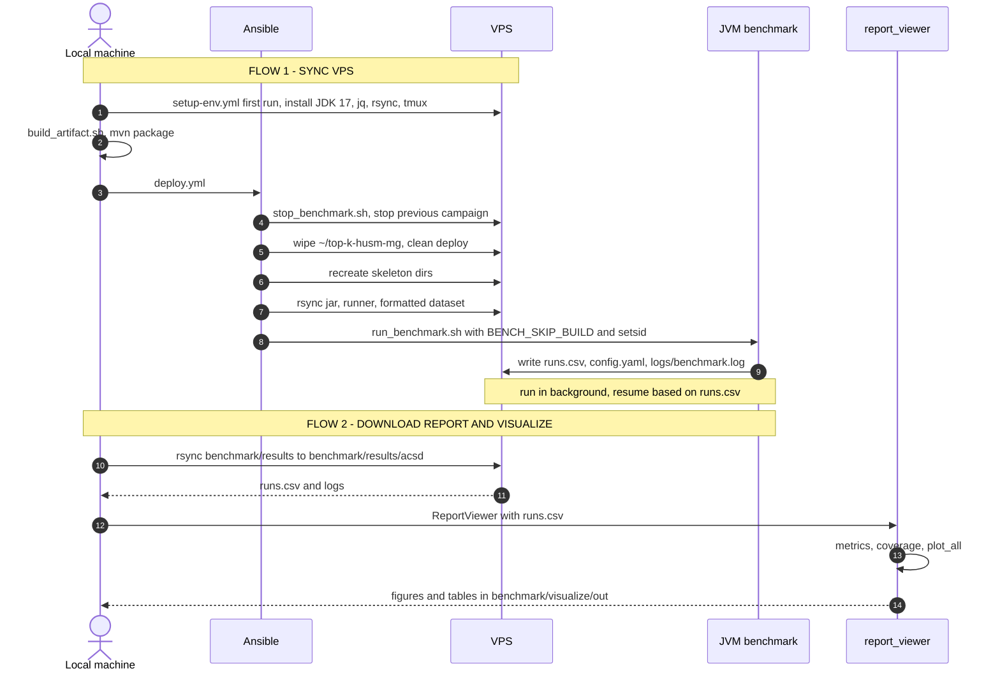

# Environment Setup Notes

## 1. Python

```bash
# Run on local.
sudo apt update
sudo apt install python3 python3-pip
pip install -r requirements.txt --break-system-packages
python3 --version
```


## 2. Run on VPS

### Flow




```bash
# Setup (one time)
ansible-playbook benchmark/compute/.ansible/setup-env.yml -k

# Run: build locally, then deploy and run the campaign on the VPS
./benchmark/runner/build_artifact.sh
ansible-playbook benchmark/compute/.ansible/deploy.yml -k

# Download the report locally for visualization
rsync -avz root@<vps-host>:~/top-k-husm-mg/benchmark/results/ benchmark/results/acsd
```

## 3. Measuring memory (benchmark)
Peak memory follows the SPMF `MemoryLogger` convention
(https://data-mining.philippe-fournier-viger.com/spmfs-architecture-4-the-memorylogger/):
